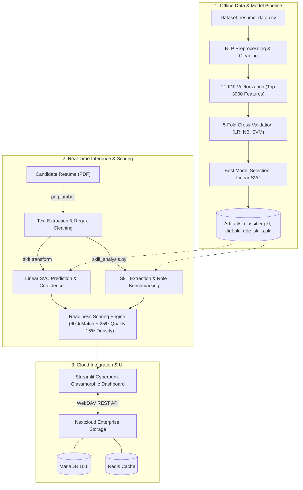

# 🚀 AI-Based Resume Role Detection & Job Readiness Analyzer

<div align="center">


<p align="center">
  <b>An intelligent, end-to-end Machine Learning pipeline & cloud-integrated web application that classifies resumes into industry job roles, benchmarks skills against market profiles, computes job readiness scores, and generates actionable career roadmaps.</b>
</p>

[Key Features](#-key-features) • [Architecture](#-system-architecture) • [ML Methodology](#-machine-learning-methodology) • [Quickstart Guide](#-quickstart-guide) • [Docker Deployment](#-docker--nextcloud-deployment) • [Project Structure](#-project-structure)

</div>

---

## 📌 Overview

Applying for jobs in competitive markets requires resumes tailored to specific industry expectations. The **AI-Based Resume Role Detection & Job Readiness Analyzer** is a full-stack career analytics platform built to bridge the gap between candidate resumes and hiring standards.

The application ingests PDF resumes (via direct upload or enterprise **Nextcloud** cloud storage), parses and cleans the text with advanced NLP routines, predicts the candidate's optimal job domain using a trained **Support Vector Machine (Linear SVM)** model, and benchmarks candidate skills against historical domain profiles using **TF-IDF vector cosine similarity**.

---

## ✨ Key Features

- **🎯 AI-Powered Role Classification**: Multi-class classification across 10 technical and professional domains with calibrated prediction confidence.
- **📊 Weighted Job Readiness Scoring (0–100%)**: Multi-faceted evaluation derived from:
  - **Skill Alignment (60%)**: Exact match against empirical industry benchmark skills.
  - **Content Quality & Depth (25%)**: Structural volume and depth compared to high-performing resumes.
  - **Domain Keyword Density (15%)**: Vocabulary overlap with top-ranked domain profiles.
- **🔍 Deep Skill Gap Analysis**:
  - **Identified Assets**: Skills identified and validated in the resume.
  - **Critical Gaps**: Expected industry competencies missing from the candidate's profile.
- **🗺️ Actionable Architectural Roadmap**: Contextual, role-specific recommendations to guide profile enhancements, certifications, and upskilling.
- **☁️ Nextcloud Enterprise Cloud Suite**:
  - Ingest PDF resumes directly from remote Nextcloud `/Resumes` repositories via WebDAV.
  - One-click cloud archival of generated candidate assessment reports to `/Candidate_Reports`.
- **🎨 Futuristic Cyberpunk / Glassmorphic UI**: High-impact Streamlit interface featuring dark neon gradients, interactive CSS cards, and real-time metric counters.
- **🐳 Enterprise-Ready Containerization**: Complete multi-container orchestration with Docker Compose (Nextcloud, MariaDB 10.6, Redis caching, and Streamlit ML app).

---

## 🏛️ System Architecture



---

## 🧠 Machine Learning Methodology

### 1. Text Preprocessing & NLP (`preprocess.py`)
Resumes often contain formatting artifacts, hyperlinks, contact details, and noise. The pipeline executes:
- Conversion to uniform lowercase.
- URL, hyperlink, and email sanitization via regex (`https?://\S+`, `\S+@\S+`).
- Punctuation, non-ASCII symbols, numbers, and newline normalization.
- Stop word filtration with NLTK English corpora.

### 2. Feature Extraction (`train_model.py`)
- **TF-IDF (Term Frequency - Inverse Document Frequency)** with a vocabulary cap of `3,000` features:
  $$\text{TF-IDF}(t, d, D) = \text{TF}(t, d) \times \log\left(\frac{1 + |D|}{1 + |\{d \in D : t \in d\}|}\right) + 1$$
- High-frequency domain indicators receive appropriate weighting while penalizing generic vocabulary.

### 3. Model Benchmark & Evaluation
Multiple classification algorithms are evaluated using **5-Fold Cross Validation (`KFold`)**:

| Model | Technique | Strengths |
| :--- | :--- | :--- |
| **Multinomial Naive Bayes** | Probabilistic Word Count | Fast baseline, handles high-dimensional sparse text. |
| **Logistic Regression** | L2-Regularized Linear Classifier | High interpretability, strong linear baseline. |
| **Support Vector Classifier (SVC)** | Linear Kernel Hyperplane Maximization | **Best Performer**: Maximizes margin in high-dimensional TF-IDF space, superior boundary separation. |

### 4. Job Readiness Formula (`scoring.py`)
The overall readiness score is computed as:

$$\text{Readiness Score} = (0.60 \times S_{\text{match}}) + (0.25 \times S_{\text{quality}}) + (0.15 \times S_{\text{keywords}})$$

Where:
- **$S_{\text{match}}$**: Intersection of candidate skills with empirical role benchmark skills:
  $$S_{\text{match}} = \frac{|\text{User Skills} \cap \text{Benchmark Skills}|}{|\text{Benchmark Skills}|} \times 100$$
- **$S_{\text{quality}}$**: Length parity against the average word count of top-performing domain profiles:
  $$S_{\text{quality}} = \max\left(0, 100 - |1 - \text{Length Ratio}| \times 100\right)$$
- **$S_{\text{keywords}}$**: Vocabulary overlap with top quartile resumes filtered by cosine similarity ($\text{sim} > 0.35$).

---

## 🎯 Supported Job Roles

The model categorizes and benchmarks resumes across diverse domains:

<div align="center">

| Technical Roles | Engineering & Legal | Business & Creative |
| :--- | :--- | :--- |
| 💻 **Data Science** | ⚙️ **Mechanical Engineer** | 👥 **Human Resources (HR)** |
| ☕ **Java Developer** | 🏗️ **Civil Engineer** | 📈 **Sales** |
| 🎨 **Web Designing** | ⚖️ **Advocate / Legal** | 🎭 **Arts / Design** |
| | | 🏃 **Health & Fitness** |

</div>

---

## 🛠️ Technology Stack

| Domain | Technologies |
| :--- | :--- |
| **Programming Language** | Python 3.10+ |
| **Machine Learning** | `scikit-learn`, `numpy`, `pandas`, `scipy` |
| **Natural Language Processing** | `nltk`, `regex` (`re`), `pdfplumber` |
| **Frontend & UI** | `streamlit`, `plotly`, CSS3 (Glassmorphism & Neon Glow) |
| **Cloud Storage & API** | `Nextcloud 28+`, `requests` (WebDAV REST protocol) |
| **Database & Cache** | `MariaDB 10.6`, `Redis (Alpine)` |
| **DevOps & Containers** | `Docker`, `Docker Compose` |

---

## 📁 Project Structure

```text
AI-Based-Resume-Role-Detection-and-Job-Readiness-Analyzer/
├── dataset/
│   ├── resume_data.csv             # Labeled training dataset across job categories
│   └── resume_data_cleaned.csv     # Pre-cleaned cache for low-latency similarity lookup
├── models/
│   ├── classifier.pkl              # Serialized Linear SVC model
│   ├── tfidf.pkl                   # Trained TF-IDF vectorizer (3000 features)
│   ├── label_encoder.pkl           # Label mapping dictionary
│   └── role_skills.pkl             # Top benchmark skills per role dictionary
├── utils/
│   └── generate_data.py            # Synthetic dataset generator for domain resumes
├── app.py                          # Streamlit application with custom CSS styling
├── train_model.py                  # Model training, 5-fold cross-validation & serialization
├── scoring.py                      # Multi-metric readiness scoring & suggestion engine
├── skill_analysis.py               # Skill dictionary extraction & benchmarking logic
├── preprocess.py                   # PDF ingestion (pdfplumber) and regex text cleaning
├── nextcloud_integration.py        # WebDAV client for Nextcloud resume sync and report archival
├── Dockerfile                      # Production Docker container image definition
├── docker-compose.nextcloud.yml    # Multi-container orchestration (Nextcloud, MariaDB, Redis, App)
├── backup_nextcloud.sh             # Linux automated backup script
├── backup_nextcloud.ps1            # Windows PowerShell backup script
├── NEXTCLOUD_PROJECT_GUIDE.md      # Detailed documentation for Nextcloud cloud architecture
├── PROJECT_EXPLANATION.md          # Comprehensive explanation and architecture guide
├── requirements.txt                # Python package dependencies
└── README.md                       # Repository documentation
```

---

## 🚀 Quickstart Guide

### Prerequisites
- Python `3.10` or higher
- Git
- (Optional) Docker & Docker Compose for containerized deployment

### 1. Clone the Repository
```bash
git clone https://github.com/Peeyush-bhadane/AI-Based-Resume-Role-Detection-and-Job-Readiness-Analyzer.git
cd AI-Based-Resume-Role-Detection-and-Job-Readiness-Analyzer
```

### 2. Create and Activate Virtual Environment
```bash
# Windows
python -m venv venv
.\venv\Scripts\activate

# Linux / macOS
python3 -m venv venv
source venv/bin/activate
```

### 3. Install Dependencies
```bash
pip install -r requirements.txt
```

### 4. (Optional) Re-Generate Dataset & Train Models
Pre-trained models are already included in the `models/` directory. To retrain from scratch:
```bash
# Generate synthetic dataset if not present
python utils/generate_data.py

# Train ML models and export artifacts to models/
python train_model.py
```

### 5. Launch the Streamlit Web Application
```bash
streamlit run app.py
```

Open your browser at `http://localhost:8501` to view the dashboard!

---

## 🐳 Docker & Nextcloud Deployment

The repository includes a complete microservices configuration with Nextcloud, MariaDB, Redis, and the AI Streamlit application.

```
                    ┌────────────────────────────────────────┐
                    │      Clients (Browser / Mobile / Sync) │
                    └───────────────────┬────────────────────┘
                                        │
                         ┌──────────────┴──────────────┐
                         ▼                             ▼
              [Port 8080: Nextcloud]        [Port 8501: Streamlit App]
                         │                             │
          ┌──────────────┼──────────────┐              │
          ▼              ▼              ▼              │
    ┌───────────┐  ┌───────────┐  ┌───────────┐        │
    │ Nextcloud │  │   Redis   │  │  MariaDB  │ ◄──────┘ (WebDAV Sync)
    │   Core    │  │   Cache   │  │    10.6   │
    └───────────┘  └───────────┘  └───────────┘
```

### 1. Configure Environment Variables
Copy the example environment configuration:
```bash
# Linux / macOS
cp .env.nextcloud.example .env

# Windows PowerShell
copy .env.nextcloud.example .env
```

### 2. Start Multi-Container Stack
```bash
docker compose -f docker-compose.nextcloud.yml up -d
```

### 3. Service Endpoints
| Service | URL | Credentials |
| :--- | :--- | :--- |
| **AI Streamlit App** | `http://localhost:8501` | *No login required* |
| **Nextcloud Cloud** | `http://localhost:8080` | `admin` / `AdminSecurePassword2026!` |

### 4. Nextcloud Cloud Storage Integration
1. Log in to Nextcloud at `http://localhost:8080`.
2. Create a folder named `Resumes` and upload candidate PDF resumes.
3. In the Streamlit sidebar, verify connection to Nextcloud.
4. Select any resume directly from the dropdown to run the full ML assessment without downloading it locally.
5. Click **"Upload Report to Nextcloud"** to automatically archive a structured `.txt` evaluation report to `/Candidate_Reports`.

---

## 📊 Sample Output & UI Tour

```
┌────────────────────────────────────────────────────────────────────────┐
│                        ML RESUME INTELLIGENCE ENGINE                   │
│             Pattern-Based Classification & Benchmarking Dashboard      │
└────────────────────────────────────────────────────────────────────────┘

  [ Classified Industry Domain ]              [ Job Readiness Score ]
          DATA SCIENCE                                84.5%

  ━━━━━━━━━━━━━━━━━━━━━━━━━━━━━━━━━━━━━━━━━━━━━━━━━━━━━━━━━━━━━━━━━━━━━━
  SKILL ANALYSIS & BENCHMARKING
  ----------------------------------------------------------------------
  ✓ IDENTIFIED ASSETS                         ✕ CRITICAL GAPS
  [ PYTHON ] [ PANDAS ] [ SCIKIT-LEARN ]      [ DOCKER ] [ PYSPARK ]
  [ SQL ]    [ MACHINE LEARNING ]             [ AWS ]

  ━━━━━━━━━━━━━━━━━━━━━━━━━━━━━━━━━━━━━━━━━━━━━━━━━━━━━━━━━━━━━━━━━━━━━━
  ARCHITECTURAL ROADMAP
  ⚡ Complete a guided project demonstrating PySpark or big data pipelines.
  ⚡ Containerize your ML applications using Docker to demonstrate MLOps.
  ⚡ Highlight cloud deployment experiences (AWS / GCP / Azure).
```

---

## 📈 Evaluation & Model Comparison Results

During 5-Fold Cross-Validation, models were evaluated on the multi-class dataset:

| Model | 5-Fold CV Accuracy | Weighted Precision | Weighted Recall | Weighted F1-Score | Status |
| :--- | :---: | :---: | :---: | :---: | :---: |
| **Multinomial Naive Bayes** | ~88.4% | 0.89 | 0.88 | 0.88 | Baseline |
| **Logistic Regression** | ~92.1% | 0.93 | 0.92 | 0.92 | Strong |
| **Support Vector Machine (Linear)** | **~96.5%** | **0.97** | **0.96** | **0.96** | 🏆 **Production** |

---

## 🛡️ Disaster Recovery & Backups

Automated backup scripts are included to safeguard MariaDB data and Nextcloud user uploads:
- **Linux / Bash**:
  ```bash
  chmod +x backup_nextcloud.sh
  ./backup_nextcloud.sh
  ```
- **Windows PowerShell**:
  ```powershell
  .\backup_nextcloud.ps1
  ```
Backups are archived into timestamped `.tar.gz` and `.sql` snapshots.

---

## 🤝 Contributing

Contributions, feedback, and feature suggestions are welcome!

1. Fork the Project.
2. Create your Feature Branch (`git checkout -b feature/NewFeature`).
3. Commit your Changes (`git commit -m 'Add NewFeature'`).
4. Push to the Branch (`git push origin feature/NewFeature`).
5. Open a Pull Request.

---

## 📄 License

Distributed under the **MIT License**. See `LICENSE` for more information.

---

## 👨‍💻 Author

**Peeyush Bhadane**
- GitHub: [@Peeyush-bhadane](https://github.com/Peeyush-bhadane)
- Repository: [AI-Based-Resume-Role-Detection-and-Job-Readiness-Analyzer](https://github.com/Peeyush-bhadane/AI-Based-Resume-Role-Detection-and-Job-Readiness-Analyzer)

<div align="center">
  <sub>Built with ❤️ using Python, Streamlit, Scikit-Learn, and Nextcloud.</sub>
</div>
